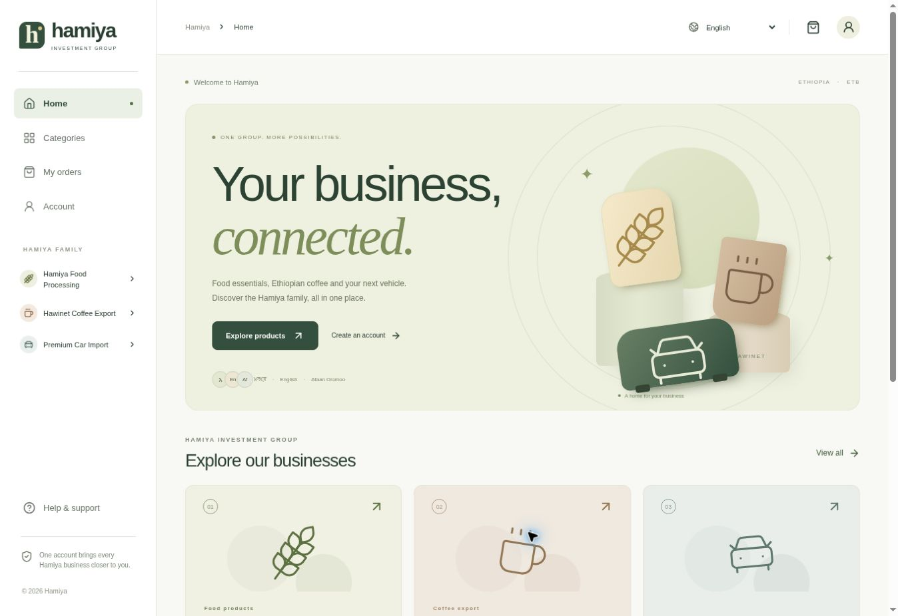

# Hamiya Customer App

A mobile-first customer and administration application for **Hamiya Investment Group**:

- Hamiya Food Processing — food orders and inventory.
- Hawinet Coffee Export — coffee listings and quotations.
- Premium Car Import — individual vehicle listings and enquiries.

The interface supports **English, Amharic and Afaan Oromo**. Customer profiles, verification documents, orders and stock live in the owner's Supabase project, `lhdsodqeojxogcwgyjpo`.



## Run locally

Requirements: Node.js 24 or later and pnpm 11.25.

```sh
npm install -g pnpm@11.25.0
pnpm install --frozen-lockfile
pnpm dev
```

Open `http://localhost:4173`. The public Supabase project configuration is included in `src/project.ts`; it contains a frontend **publishable** key, not an administrative credential. Every protected operation is enforced by the database.

To target a different project, copy `.env.example` to `.env.local` and supply that project's URL and publishable key. Never put a secret or service-role key in a `VITE_` variable. The build rejects secret keys and legacy keys with a role other than `anon`.

```sh
pnpm test
pnpm build
pnpm preview
```

`pnpm build` type-checks TypeScript and produces `dist/`. Deploy that directory to an HTTPS static host. The application uses hash routing, so additional SPA rewrite rules are unnecessary. An installable PWA manifest, raster app icons and a service worker are included. The service worker caches the public application shell and static assets; it never caches Supabase responses, documents or orders.

## Connected database

The initial schema and explicit private-table denial policies have been applied to the supplied project. **Do not rerun `supabase/setup.sql` on that project.** It is the complete, transaction-wrapped setup script for a fresh empty project and is retained for review and reproducibility. It deliberately fails on an existing installation instead of altering unknown business data.

All business tables use the `hamiya_` prefix. Sensitive identity hashes and staff permissions are in the non-exposed `hamiya_private` schema. All tables have RLS enabled. Browser roles have SELECT access according to ownership or staff responsibility; writes use the authenticated `hamiya_action` RPC and its private, permission-checked dispatcher.

The following are installed:

- Required business profiles and verification states.
- Private `hamiya-documents` bucket, with ownership/reviewer policies.
- Separate public `hamiya-products` bucket for product photographs.
- Food, coffee and vehicle catalogues with translated content fields.
- Orders, quotations, enquiries and audited stock adjustments.
- Atomic stock reservations with deterministic product-row locking.
- Idempotency keys for order submission and stock adjustments.
- Realtime catalogue, order, enquiry and profile updates.

## First administrator

Register and confirm the owner's account through the app first. In the Supabase SQL editor, assign the intended account explicitly:

```sql
insert into hamiya_private.staff_roles (user_id, role)
select id, 'admin'
from auth.users
where email = 'REPLACE_WITH_THE_REGISTERED_OWNER_EMAIL'
on conflict (user_id) do update set role = excluded.role, enabled = true;
```

Sign in again or refresh Account. Administration appears in the menu. Other supported staff roles are `reviewer` and `inventory`. Reviewers can inspect verification documents; inventory staff cannot. There is no public "make me admin" operation, automatic first-user promotion, seeded password or hardcoded administrator email.

## Publish the supplied food products

The eleven supplied products and original source entries are saved as **drafts**. Prices and supplied counts are preserved; opening inventory is zero. Draft products are visible in administration and excluded from the public catalogue.

For each product:

1. Confirm what Hard/Softi means and the quantity of units in each package.
2. Confirm the selling unit for the listed price: piece, packet, carton, or another unit.
3. Supply the missing Cappuccino Softi pack count.
4. Confirm selling details in the product editor.
5. Record actual opening stock through **Manage stock → Add stock**.
6. Add an approved product photo and descriptions/translations.
7. Set status to Available and enable customer visibility.

Changing a food product's stock does not alter its pack count. An accepted order reserves stock; completion converts that reservation into a sale exactly once. Cancellation releases it. Submitted requests alone do not reserve stock. Reservations remain until completion or cancellation; no automatic expiry has been configured. Individual vehicle records can be reserved or sold without affecting other vehicles.

Delivery is disabled by default. Administrators must explicitly configure a delivery fee, including an intentional zero fee, before enabling it. Collection is enabled. All totals use integer ETB cents. Catalogue price changes do not rewrite submitted order snapshots. This phase records no successful payments and contains no payment gateway.

## Authentication and email setup

Supabase Auth handles account creation, email confirmation, sessions and password recovery. Before launching a hosted URL:

1. Configure that exact application URL in Supabase Auth's Site URL and redirect allow list. Include the required development URL separately if testing locally. Avoid broad wildcard production redirects.
2. Keep email confirmation enabled.
3. Configure a production email delivery service in Supabase Auth and verify actual delivery.
4. Install `supabase/templates/confirmation.html` and `supabase/templates/recovery.html` in the corresponding Supabase email template settings. Their content selects English, Amharic or Afaan Oromo from `user_metadata.language`.

Template files are supplied in the repository; uploading them to Auth configuration and real email delivery have not been claimed as completed. The app never simulates a successful confirmation or recovery. Database approval checks Supabase's server-maintained email confirmation timestamp.

## Registration and privacy

Customers can browse published catalogues. Orders and purchase enquiries require a complete, approved profile and verified email. Required information includes legal and business names, phone, email, address, landmark, National ID, trade license, profile photo and supporting documents. Sub-city, woreda and kebele are collected where applicable. GPS is optional; manual address completion remains available.

Progress can be saved to the authenticated profile. National ID text and documents are not stored in catalogue/cart caches. The database retains a salted National ID hash and a masked suffix; the supporting document is private. Uploads use unique immutable names, a bucket-enforced size/MIME allow list and client file-signature checks. Authorized document links expire after 60 seconds and document access is audited.

Before collecting real identity documents, the company must review the provisional privacy/terms text, provide its privacy contact and retention schedule, and approve native-language translations. Deletion requests are recorded for authorized review; the app does not falsely tell customers their account has already been erased. File malware scanning and automated retention/deletion jobs are not configured.

## Verification

`tests/database.test.mjs` executes the actual schema and RPC in PGlite, a PostgreSQL runtime, with test-only Supabase Auth and Storage schema fixtures. It tests ownership policies, staff permissions, required documents, National ID masking, publishing gates, stale prices, duplicate orders, competing reservations, cancellation, fulfilment and sold-vehicle rejection.

These tests validate SQL behaviour; they do not replace a real multi-connection load test or a hosted customer signup/email/upload journey. See `docs/VERIFICATION.md` for live checks and remaining launch inputs.

The current visual identity is a provisional Hamiya wordmark and restrained olive/cream palette. Product photos, coffee listings, vehicle listings, contact details and stock have not been fabricated. Replace the provisional assets with the owner's approved branding before public launch.
